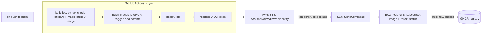

# 12. Deployment: AWS + k3s + GitHub Actions

The backend API and Streamlit UI run as two containers on a single EC2 instance running k3s
(lightweight Kubernetes). GitHub Actions builds the images and deploys them using short-lived
AWS credentials (OIDC) and SSM, with no SSH, no open Kubernetes API, and no stored AWS keys.

---

## 1. CI/CD flow

- **Pull requests:** build only (proves the Dockerfiles work). Nothing is pushed or deployed.
- **Push to `main`:** build, push, then deploy.
- **Image tags:** the short commit SHA (e.g. `sha-ab12cd3`), so every running pod maps to an exact commit.
- **Deploy trust:** the role can only be assumed by a token from this repo on `main`
  (trust policy matches the exact `sub` claim, which embeds the immutable owner and repo IDs).

---

## 2. Runtime architecture

```mermaid
flowchart LR
    User["Browser"] --> Ip["Public IP"]
    Ip --> Igw["Internet Gateway"]
    Igw --> Sg["Security Group: port 80"]

    subgraph ec2 [EC2 instance: k3s single node]
        Traefik["Traefik ingress"]
        UiSvc["Service rag-ui"]
        UiPod["UI pod (Streamlit :8501)"]
        ApiSvc["Service rag-api (ClusterIP)"]
        ApiPod["API pod (FastAPI :8080)"]
        Traefik --> UiSvc --> UiPod
        UiPod -->|"http://rag-api"| ApiSvc --> ApiPod
    end

    Sg --> Traefik
    ApiPod --> Saas["Qdrant Cloud, Groq via Portkey, Gemini, LangSmith, Logfire"]
```

- Only the **UI** is exposed. The API is `ClusterIP`-only and reached through cluster DNS, because it
  has no authentication and spends LLM quota.
- k3s bundles Traefik, so no cloud load balancer is needed.

---

## 3. AWS resources used

| Resource | Name / setting | Purpose |
|----------|----------------|---------|
| Account safety | Root MFA, IAM admin user with MFA | Daily work is never done as root |
| AWS Budgets | Monthly cost alert | Early warning (alerts only, no hard cap) |
| VPC | `learn-vpc`, `10.0.0.0/16` | Private network |
| Subnet | `learn-public-a`, `10.0.1.0/24`, `ap-south-1a` | Public subnet (route to the IGW) |
| Internet Gateway + route | `learn-igw`, `0.0.0.0/0 -> IGW` | Internet access |
| Security group | `learn-web-sg`: 80/443 inbound, **no SSH** | Stateful firewall; restrict the source to your own IP |
| EC2 instance | `learn-k3s`, `t3.small` (x86), Ubuntu 24.04, 20 GiB encrypted gp3, IMDSv2 required | Runs k3s and both pods |
| IAM role + instance profile | `learn-ssm-role` (`AmazonSSMManagedInstanceCore`) | Lets the instance register with SSM (no keys on disk) |
| SSM | Session Manager (shell) and Run Command (deploys) | Access and deploys without SSH |
| IAM OIDC provider | `token.actions.githubusercontent.com`, audience `sts.amazonaws.com` | Lets AWS trust GitHub-issued tokens |
| IAM role (CI) | `github-deploy-role` | Assumed by the deploy job |
| Elastic IP (optional) | n/a | Keeps the public IP stable across stop and start |

**`github-deploy-role` permissions (least privilege):**
`ssm:SendCommand` on the one instance and the `AWS-RunShellScript` document, plus `ssm:GetCommandInvocation`.

**Not AWS:** container images live in GitHub Container Registry (GHCR), free, packages set to public.

Region: `ap-south-1` (Mumbai).

---

## 4. GitHub configuration

| Item | Where | Value |
|------|-------|-------|
| Workflow | `.github/workflows/ci.yml` | build + deploy jobs |
| `AWS_ROLE_ARN` | Settings, Actions, **Variables** | ARN of `github-deploy-role` |
| `EC2_INSTANCE_ID` | Settings, Actions, **Variables** | Instance ID of `learn-k3s` |
| Registry login | built-in `GITHUB_TOKEN` | `packages: write` only; no personal token stored |
| Deploy job permissions | job-level | `id-token: write` (enables OIDC), `contents: read` |

---

## 5. Kubernetes objects (`k8s/`)

| File | Object | Notes |
|------|--------|-------|
| `deployment.yaml` | Deployment `rag-api` | Probes, 1 Gi request / 1500 Mi limit, `Recreate` strategy (node too small for two API pods) |
| `service.yaml` | Service `rag-api` | ClusterIP 80 -> 8080 (internal only) |
| `ui-deployment.yaml` | Deployment `rag-ui` | `BACKEND_URL=http://rag-api`; only `LOGFIRE_TOKEN` from the secret |
| `ui-service.yaml` | Service `rag-ui` | ClusterIP 80 -> 8501 |
| `ingress.yaml` | Ingress `rag-ui` | Single public route `/` to the UI |
| (created by hand) | Secret `rag-api-env` | Created from `.env` on the server; never committed |

---

## 6. Operations

**First-time setup (once):** create the Secret, then `kubectl apply` the manifests with the real image tag.
After that, the pipeline only updates the image tag with `kubectl set image`.

**Daily habits**
- Stop the instance when not in use (compute billing stops; disk and IP still bill).
- The deploy job fails if the instance is stopped (SSM cannot reach it).
- Without an Elastic IP, the public IP changes after every stop and start.

**Useful checks (run on the server with `sudo k3s kubectl ...`)**
- `get pods` : ready state and restarts
- `describe pod -l app=rag-api` : events and last state (e.g. `OOMKilled`)
- `logs -l app=rag-api --tail=50` : application output
- `rollout undo deployment/rag-api` : roll back to the previous version
- `get deployment rag-api -o jsonpath='{.spec.template.spec.containers[0].image}'` : running tag

---

## 7. Known limitations

- **Brief downtime on deploy:** `Recreate` stops the old pod first, because the 2 GB node cannot run two API pods.
- **Plain HTTP:** no TLS yet (needs a domain and a certificate).
- **Manifest drift:** the pipeline updates only the image; other manifest edits still need a manual `kubectl apply`.
- **Secrets are created by hand:** AWS Secrets Manager or Parameter Store is the next step.
- **`terraform/` is not what was built:** the Terraform files default to `t4g.small` (ARM), while the hand-built
  instance is `t3.small` (x86). Align `instance_type` and `architecture` before using them.
